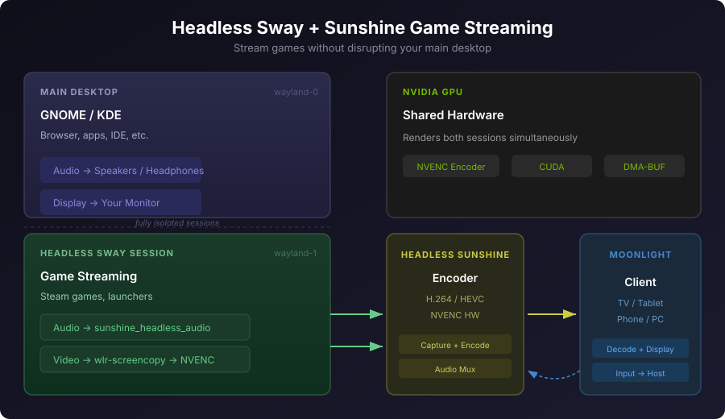

# Headless Sway + Sunshine Game Streaming

> **DISCLAIMER**: This is provided as-is with absolutely no warranty or guarantee. Use at your own risk. This may break your system, eat your configs, set your GPU on fire, or summon an elder god. The author(s) take no responsibility for anything that happens as a result of using this software. You have been warned.



Stream games from a headless Sway session using [Sunshine](https://github.com/LizardByte/Sunshine) and [Moonlight](https://moonlight-stream.org/), without disrupting your main desktop session. The installer keeps the headless Sunshine instance, pairing identity, credentials, apps, and ports separate from a normal Sunshine installation.

This setup runs a separate headless Wayland compositor (Sway) dedicated to game streaming. Your primary desktop (GNOME, KDE, etc.) continues running normally — audio, display, and input are fully isolated.

## Why headless?

- Stream games without taking over your main display
- Dynamic resolution matching — the headless output adapts to your Moonlight client
- Game audio routes only to the stream, host audio is unaffected
- Works with NVIDIA GPUs using NVENC hardware encoding
- Minimal overhead when idle (~420MB RAM, negligible CPU)

## Requirements

- **OS**: Linux with systemd user services (tested on CachyOS/Arch, Ubuntu 25.10, and Fedora 44 Workstation)
- **GPU**: NVIDIA with proprietary drivers (for NVENC)
- **Packages**: `sway`, `swaybg`, `foot`, `pipewire`, `wireplumber`, `pactl`, `xdg-desktop-portal-wlr`
- **Games**: Steam installed on the host for the Steam Big Picture entry
- **Sunshine**: [LizardByte Sunshine](https://github.com/LizardByte/Sunshine/releases) v2026.226+ (RPM, DEB, or Arch package)
- **Client**: [Moonlight](https://moonlight-stream.org/) on any device

Sway rejects proprietary NVIDIA drivers by default. The headless service opts in
with `--unsupported-gpu`; this has been tested with the NVIDIA 615 driver,
wlroots 0.19, and Sunshine NVENC on Fedora 44. Other driver versions may behave
differently.

## Quick install

```bash
git clone https://github.com/daaaaan/sunshine-headless-sway.git
cd sunshine-headless-sway
./install.sh
```

The install script will:
- Install missing dependencies (`sway`, `swaybg`, `foot`, `xdg-desktop-portal-wlr`) via pacman, dnf, or apt
- Auto-detect your desktop environment (GNOME or KDE) for input isolation
- Auto-detect your Sunshine installation path
- Detect the correct Wayland display number and user ID
- Template all config files with your system's paths
- Install and enable the systemd services
- Keep the headless Sunshine config and pairing identity in `~/.config/sunshine-headless`, leaving `~/.config/sunshine` untouched
- Set a separate port family (base port 48989; override with `SUNSHINE_HEADLESS_PORT`)
- Install per-device input-isolation rules without adding your user to the broad `input` group
- Restart PipeWire briefly to load the persistent stream-only audio sink

The `sunshine-headless` instance appears separately in Moonlight. If discovery
does not show it, add the host as `HOST_IP:48989`. Its Web UI is
`https://localhost:48990` by default.

## Manual setup

If you prefer to install manually, see the [manual setup guide](#manual-setup-guide) below.

## Architecture

```
┌─────────────────────────────────────────────────────┐
│  Main Desktop (GNOME/KDE)          wayland-0        │
│  └─ Normal apps, browser, etc.                      │
│  └─ Audio → your speakers/headphones                │
├─────────────────────────────────────────────────────┤
│  Headless Sway                     wayland-1        │
│  └─ Games launched via Sunshine                     │
│  └─ Audio → sunshine_headless_audio → Moonlight stream │
│  └─ Video → wlr-screencopy → NVENC → Moonlight     │
└─────────────────────────────────────────────────────┘
```

Two systemd user services manage the stack:

1. **`sway-sunshine.service`** — runs a headless Sway compositor with no physical display
2. **`sunshine-headless.service`** — runs Sunshine pointed at the headless Sway session

## Adding games

Edit `~/.config/sunshine-headless/apps.json` to add Steam games. Find the app ID on [SteamDB](https://steamdb.info/) and add an entry:

```json
{
  "name": "Game Name",
  "detached": [
    "/home/YOUR_USER/.config/sway-sunshine/start-steam-game.sh APP_ID"
  ],
  "prep-cmd": [
    {
      "do": "~/.config/sway-sunshine/set-resolution.sh",
      "undo": "/home/YOUR_USER/.config/sway-sunshine/stop-steam-game.sh"
    }
  ]
}
```

Replace `YOUR_USER` with your username. Restart Sunshine after editing:
`systemctl --user restart sunshine-headless.service`.

Launching **Steam Big Picture (Deck)** or a Steam game temporarily closes an
already-running Steam client so it can start inside headless Sway. When the
stream ends, the stop hook relaunches Steam in the original desktop if it had
been running before.

## How it works

### NVIDIA + headless Sway renderer

The Sway service uses `WLR_RENDERER=gles2` by default. Older wlroots versions have DRM format modifier incompatibilities with NVIDIA's headless backend when using the Vulkan renderer. This may be resolved in wlroots 0.18+, but gles2 remains the safe default.

### Audio isolation

Headless Sway applications route to a dedicated PipeWire null sink named
`sunshine_headless_audio`. This name is intentionally different from Sunshine's
own `sink-sunshine-stereo` sink to avoid duplicate PipeWire/PulseAudio monitor
names.

- The PipeWire drop-in creates `sunshine_headless_audio` persistently.
- `PULSE_SINK=sunshine_headless_audio` is set for the headless Sway session and
  Steam launch commands.
- `audio_sink = sunshine_headless_audio` tells Sunshine to capture that sink's
  monitor explicitly.
- Sunshine selects its own `sink-sunshine-*` output when initializing stream
  audio. The app prep command starts `sunshine-audio-guard.service`, which
  remembers GNOME's current output, restores it if Sunshine changes the default,
  and moves any host streams redirected to a Sunshine sink back to that output.
  The guard stays active for the app session, so it also catches reconnects and
  resumed Moonlight sessions. The explicit `audio_sink` keeps Sunshine capture
  attached to the headless monitor.
- Host GNOME audio continues through its normal output. Apps in Sway remain
  silent locally when the stream is disconnected.

The installer preserves an existing `~/.config/sunshine-headless/apps.json`.
For an existing setup, add this prep-cmd entry to each app so the guard covers
the complete app session, including Moonlight reconnects:

```json
{
  "do": "systemctl --user start sunshine-audio-guard.service",
  "undo": "systemctl --user stop sunshine-audio-guard.service"
}
```

WirePlumber can remember an application's previous sink from a GNOME session.
If a game's audio still goes to the host after setup, connect to the stream and
move that game's current sink input to the stream sink once:

```bash
pactl list short sink-inputs
pactl move-sink-input <ID> sunshine_headless_audio
```

WirePlumber persists that per-application routing choice. Confirm the game
appears under `sunshine_headless_audio` in `wpctl status`, while the GNOME
desktop's streams remain on the normal hardware sink.

### Dynamic resolution

When a Moonlight client connects, Sunshine runs `set-resolution.sh` as a prep
command. This uses `SUNSHINE_CLIENT_WIDTH`, `SUNSHINE_CLIENT_HEIGHT`, and
`SUNSHINE_CLIENT_FPS` to resize the headless output to match the client. The
fallback/reset mode is 1280×800@90 Hz for the Steam Deck OLED.

### Wayland display numbering

The headless Sway session typically gets `wayland-1` (assuming your main desktop is `wayland-0`). The install script detects this automatically. To check manually:

```bash
ls /run/user/$(id -u)/wayland-*
```

### IPC socket

Sway creates its IPC socket at the path specified by `SWAYSOCK` (`/run/user/<uid>/sway-sunshine.sock`). The service cleans up stale sockets on restart via `ExecStartPre`. All `swaymsg` commands in the apps and scripts reference this socket explicitly.

## Troubleshooting

### Blank display / error code -1

- Check `~/.config/sunshine-headless/sunshine.log` for `Frame capture failed`
- Ensure `WLR_RENDERER=gles2` is set in `sway-sunshine.service` (not `vulkan`)
- Verify Sunshine is connecting to the correct Wayland display

### Input isolation

Input is isolated between your desktop and the streaming session. Sunshine
creates virtual keyboard/mouse devices (`0xBEEF:0xDEAD`) and virtual gamepads
such as Xbox Series (`0x045E:0x0B13`) or DualSense (`0x054C:0x0CE6`). The udev
rules hide these devices from the host compositor while granting access only
to the account running the headless session.

The install script **auto-detects your desktop environment** and installs the appropriate udev rule. Both approaches install to `/etc/udev/rules.d/85-sunshine-input-isolation.rules`.

#### GNOME (Mutter)

Uses the `mutter-device-ignore` property — a targeted GNOME-specific mechanism
that tells Mutter to skip the virtual devices while leaving them available to
headless Sway and games:

```udev
ACTION=="add|change", SUBSYSTEM=="input", ATTRS{id/vendor}=="beef", ATTRS{id/product}=="dead", ENV{mutter-device-ignore}="1"
ACTION=="add|change", SUBSYSTEM=="input", ATTRS{id/vendor}=="054c", ATTRS{id/product}=="0ce6", ENV{mutter-device-ignore}="1"
ACTION=="add|change", SUBSYSTEM=="input", ATTRS{id/vendor}=="045e", ATTRS{id/product}=="0b13", ENV{mutter-device-ignore}="1"
```

#### KDE (KWin)

KWin has no equivalent to `mutter-device-ignore`. Instead, the udev rule strips `ID_INPUT` tags so KWin never discovers the devices as inputs:

```udev
ACTION=="add|change", SUBSYSTEM=="input", ATTRS{id/vendor}=="beef", ATTRS{id/product}=="dead", ENV{ID_INPUT}="", ENV{ID_INPUT_KEYBOARD}="", ENV{ID_INPUT_MOUSE}="", ENV{ID_INPUT_TOUCHPAD}=""
ACTION=="add|change", SUBSYSTEM=="input", ATTRS{id/vendor}=="054c", ATTRS{id/product}=="0ce6", ENV{ID_INPUT}="", ENV{ID_INPUT_KEYBOARD}="", ENV{ID_INPUT_MOUSE}="", ENV{ID_INPUT_TOUCHPAD}=""
ACTION=="add|change", SUBSYSTEM=="input", ATTRS{id/vendor}=="045e", ATTRS{id/product}=="0b13", ENV{ID_INPUT}="", ENV{ID_INPUT_KEYBOARD}="", ENV{ID_INPUT_MOUSE}="", ENV{ID_INPUT_TOUCHPAD}=""
```

> **Note**: The KDE method also works for GNOME and other compositors, but is more aggressive — it hides the devices from *all* desktop tools (e.g., Settings panels). The `mutter-device-ignore` method is preferred for GNOME since it's more targeted.

#### How isolation works

- The **udev rule** prevents the host compositor from claiming Sunshine's virtual inputs (method varies by DE, see above)
- The headless Sway uses `WLR_BACKENDS=headless,libinput` with `LIBSEAT_BACKEND=noop`; per-device udev permissions avoid adding the user to the broad `input` group
- The **Sway config** disables all physical host devices and only enables Sunshine's passthrough devices, so your physical keyboard and mouse don't leak into the streaming session
- Gamepads are read directly by Steam via evdev, bypassing the compositor entirely

#### Switching DE method manually

If you switch desktop environments, reinstall the appropriate rule:

```bash
# For GNOME
sed "s|__USER__|$(id -un)|g" udev/85-sunshine-input-isolation-gnome.rules \
  | sudo tee /etc/udev/rules.d/85-sunshine-input-isolation.rules >/dev/null

# For KDE
sed "s|__USER__|$(id -un)|g" udev/85-sunshine-input-isolation-kde.rules \
  | sudo tee /etc/udev/rules.d/85-sunshine-input-isolation.rules >/dev/null

# Reload
sudo udevadm control --reload-rules
```

### No input / can't control games

- The `xdg-desktop-portal-wlr` package must be installed
- Check that `/dev/uinput` is accessible to your user (Sunshine's udev rules should handle this)
- Verify the libinput backend is active: `SWAYSOCK=/run/user/$(id -u)/sway-sunshine.sock swaymsg -t get_inputs` should show the Sunshine keyboard/mouse passthrough devices enabled
- Sunshine defaults to an Xbox Series virtual pad (`0x045E:0x0B13`); it is read directly by the game through evdev. Sony virtual pads (`0x054C:0x0CE6`) are also isolated by the udev rules.

### Games don't launch

- Verify the Sway IPC socket exists: `ls -la /run/user/$(id -u)/sway-sunshine.sock`
- Test manually: `SWAYSOCK=/run/user/$(id -u)/sway-sunshine.sock swaymsg -t get_tree`
- If the socket is stale after a restart, the `ExecStartPre` cleanup in the service handles it

### Audio bleeds to host or is missing from Moonlight

- Verify `audio_sink = sunshine_headless_audio` is in `~/.config/sunshine-headless/sunshine.conf` and `PULSE_SINK=sunshine_headless_audio` is in `sway-sunshine.service`.
- Check the guard during a stream with `systemctl --user status sunshine-audio-guard.service`; its log should say it is protecting the currently selected host output.
- Confirm the persistent sink exists with `wpctl status`.
- If an application remembers its GNOME output, connect to a stream and move its active sink input to `sunshine_headless_audio` once:

  ```bash
  pactl list short sink-inputs
  pactl move-sink-input <ID> sunshine_headless_audio
  ```

  WirePlumber remembers the per-application route. The audio guard restores GNOME's default output if Sunshine changes it during a stream or reconnect.

### UPnP port mapping failures

These errors (`Failed to map UDP/TCP`) are harmless if you're connecting over LAN or a VPN like Tailscale. They only matter for WAN connections through your router.

## Manual setup guide

If you'd rather not use the install script:

### 1. Install dependencies

**Arch / CachyOS:**
```bash
sudo pacman -S sway swaybg foot xdg-desktop-portal-wlr libpulse
```

**Ubuntu / Debian:**
```bash
sudo apt install sway swaybg foot xdg-desktop-portal-wlr pulseaudio-utils
```

**Fedora:**
```bash
sudo dnf install sway swaybg foot xdg-desktop-portal-wlr pulseaudio-utils
```

### 2. Copy config files

```bash
USER_ID="$(id -u)"
XDG_RUNTIME_DIR="${XDG_RUNTIME_DIR:-/run/user/$USER_ID}"
HEADLESS_DISPLAY=wayland-1 # Set this to Sway's next free Wayland socket.
MAIN_WAYLAND_DISPLAY="${WAYLAND_DISPLAY:-wayland-0}"
MAIN_DESKTOP="${XDG_CURRENT_DESKTOP:-GNOME}"
SUNSHINE_PATH="$(command -v sunshine)"
SUNSHINE_BASE_PORT=48989

# Sway config and scripts
mkdir -p ~/.config/sway-sunshine
cp sway-sunshine/config sway-sunshine/*.sh ~/.config/sway-sunshine/
chmod +x ~/.config/sway-sunshine/*.sh

# Headless Sunshine config/state (do not reuse ~/.config/sunshine)
mkdir -p ~/.config/sunshine-headless/credentials
sed -e "s|/home/YOUR_USER|$HOME|g" \
  -e "s|port = 48989|port = $SUNSHINE_BASE_PORT|g" \
  sunshine/sunshine.conf \
  > ~/.config/sunshine-headless/sunshine.conf
sed -e "s|/home/YOUR_USER|$HOME|g" \
  -e "s|/run/user/1000|$XDG_RUNTIME_DIR|g" \
  -e "s|wayland-1|$HEADLESS_DISPLAY|g" \
  sunshine/apps.json \
  > ~/.config/sunshine-headless/apps.json

# PipeWire persistent audio sink
mkdir -p ~/.config/pipewire/pipewire.conf.d
cp pipewire/sunshine-null-sink.conf ~/.config/pipewire/pipewire.conf.d/
systemctl --user restart pipewire.service

# Systemd services
mkdir -p ~/.config/systemd/user
sed -e "s|wayland-1|$HEADLESS_DISPLAY|g" \
  systemd/sway-sunshine.service > ~/.config/systemd/user/sway-sunshine.service
sed -e "s|wayland-1|$HEADLESS_DISPLAY|g" \
  -e "s|__MAIN_WAYLAND_DISPLAY__|$MAIN_WAYLAND_DISPLAY|g" \
  -e "s|__MAIN_DESKTOP__|$MAIN_DESKTOP|g" \
  -e "s|__SUNSHINE_PATH__|$SUNSHINE_PATH|g" \
  -e "s|__SUNSHINE_CONFIG_PATH__|$HOME/.config/sunshine-headless/sunshine.conf|g" \
  systemd/sunshine-headless.service > ~/.config/systemd/user/sunshine-headless.service
cp systemd/sunshine-audio-guard.service ~/.config/systemd/user/

# Install the GNOME example rule; use the KDE rule instead on Plasma.
sed "s|__USER__|$(id -un)|g" udev/85-sunshine-input-isolation-gnome.rules \
  | sudo tee /etc/udev/rules.d/85-sunshine-input-isolation.rules >/dev/null
sudo udevadm control --reload-rules
```

The service templates above assume the next free Wayland socket is `wayland-1`.
If yours differs, update `HEADLESS_DISPLAY` before copying the files. For KDE,
substitute `udev/85-sunshine-input-isolation-kde.rules` in the udev command.

### 4. Enable and start

```bash
systemctl --user daemon-reload
systemctl --user enable --now sway-sunshine.service
systemctl --user enable --now sunshine-headless.service
```

### 5. Pair with Moonlight

Open the headless Sunshine UI at `https://localhost:48990` and create its
separate credentials. Add the host to Moonlight as `HOST_IP:48989` if mDNS does
not show the second Sunshine instance, then enter Moonlight's PIN in this
headless instance's **PIN** page.

## File structure

```
/etc/udev/rules.d/
└── 85-sunshine-input-isolation.rules  # Installed by install.sh (GNOME or KDE variant)

~/.config/
├── pipewire/pipewire.conf.d/
│   └── sunshine-null-sink.conf # Persistent sunshine_headless_audio sink
├── sway-sunshine/
│   ├── config                  # Headless Sway compositor config (input isolation)
│   ├── defaults.env            # Default output mode (width/height/fps)
│   ├── set-resolution.sh       # Dynamic resolution on connect
│   ├── reset-resolution.sh     # Reset resolution on disconnect
│   ├── protect-host-audio.sh  # Restores GNOME output if Sunshine switches it, including on reconnect
│   ├── start-steam-game.sh     # Moves an existing Steam client into headless Sway
│   └── stop-steam-game.sh      # Stops stream Steam and restores it to the host desktop
├── sunshine-headless/
│   ├── sunshine.conf           # Isolated config
│   └── apps.json               # Headless game/app entries for Moonlight
└── systemd/user/
    ├── sway-sunshine.service   # Headless Sway compositor service
    ├── sunshine-headless.service # Sunshine streaming service
    └── sunshine-audio-guard.service # Preserves the host audio output while streaming
```

## License

MIT — do whatever you want with it, but don't blame us if something breaks.
